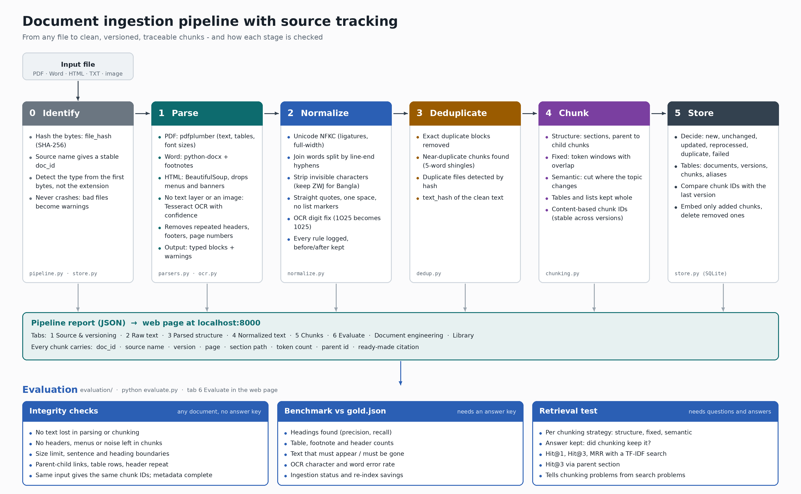
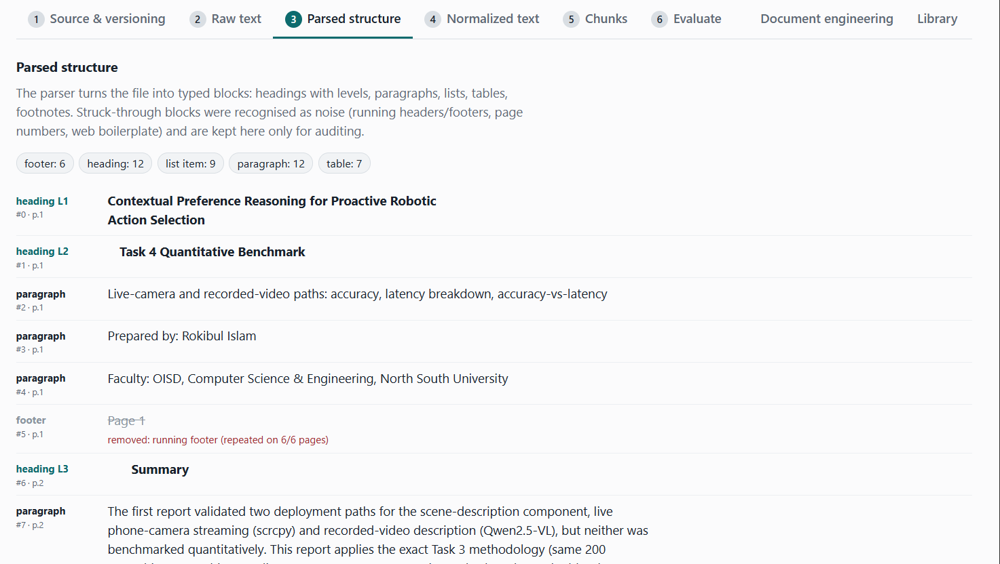
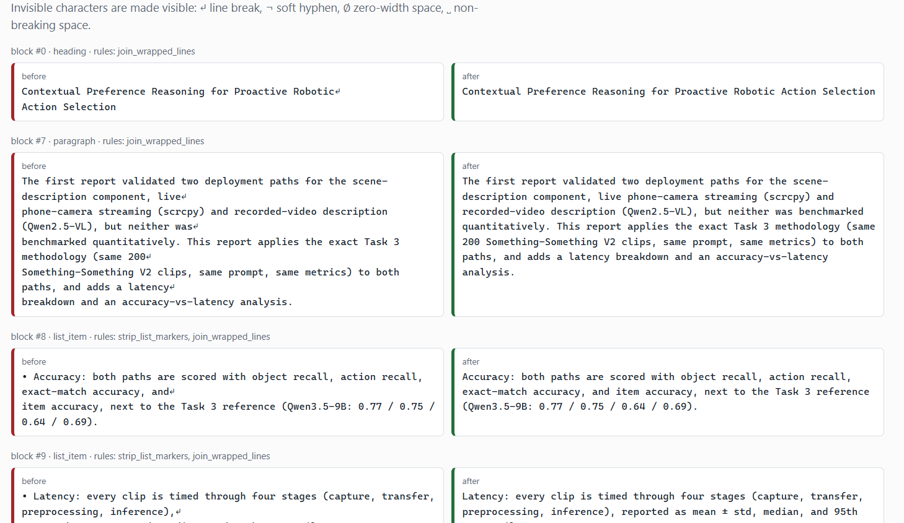
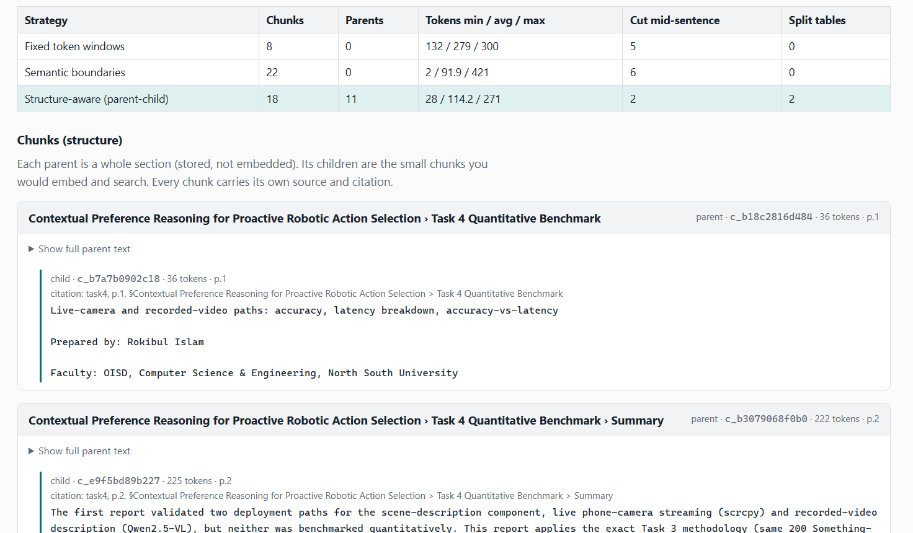
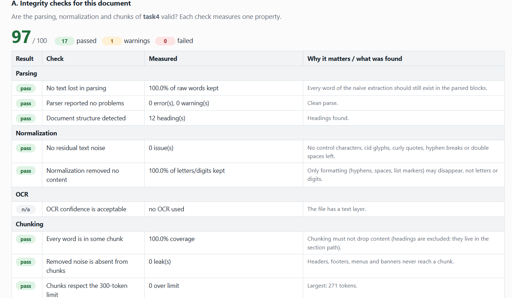
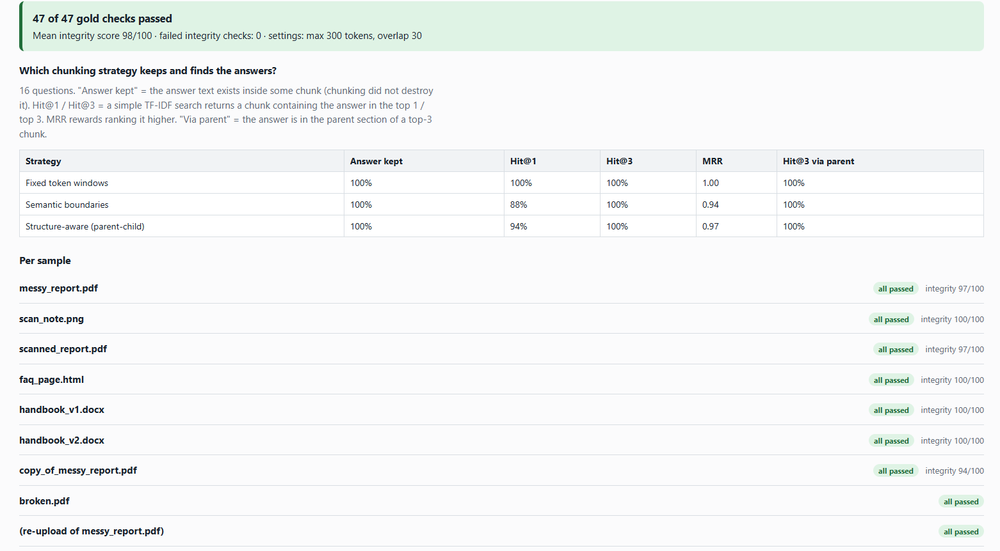

# Document Ingestion Pipeline (with Source Tracking)

A production-grade, deterministic document ingestion pipeline designed for **Retrieval-Augmented Generation (RAG)** systems. Transforms unstructured files into clean, traceable, deduplicated, and versioned chunks with verifiable provenance.

Upload a **PDF**, **Word file**, **HTML page**, **text file**, or **image of text**, and watch it pass through:
$$\text{Raw Extraction} \longrightarrow \text{Parsing} \longrightarrow \text{Normalization} \longrightarrow \text{Deduplication} \longrightarrow \text{Chunking} \longrightarrow \text{Versioned Storage}$$

---

## Architecture Overview



```
 upload (PDF / DOCX / HTML / TXT / image)
        │
        ▼
 ┌───────────────┐   file bytes ──► file_hash (SHA-256)
 │ 0. Identify   │   source name ─► doc_id   (stable)
 └──────┬────────┘
        ▼
 ┌───────────────┐   PDF  → pdfplumber (text layer, tables, font hierarchy) ── no text? → OCR fallback
 │ 1. Parse      │   DOCX → python-docx (+ footnotes.xml)       Image → Tesseract OCR
 │  parsers.py   │   HTML → BeautifulSoup                       TXT   → paragraphs
 └──────┬────────┘   Output: typed Blocks + warnings + "naive" raw text (for comparison)
        ▼
 ┌───────────────┐   Unicode NFKC · de-hyphenate · strip invisible chars · straighten quotes
 │ 2. Normalize  │   strip list markers · join wrapped lines · collapse whitespace · OCR digit fix
 │  normalize.py │   Every rule is logged per block (before/after diff kept for auditing)
 └──────┬────────┘
        ▼
 ┌───────────────┐   Exact duplicate blocks removed (text_hash SHA-256)
 │ 3. Deduplicate│   Near-duplicate chunks reported (5-word shingles)
 │  dedup.py     │   Duplicate files detected via content hash
 └──────┬────────┘
        ▼
 ┌───────────────┐   Structure-aware (parent-child) │ Fixed token windows │ Semantic boundaries
 │ 4. Chunk      │   Content-addressed chunk IDs, section path, page range, token counts
 │  chunking.py  │
 └──────┬────────┘
        ▼
 ┌───────────────┐   Decide: new / unchanged / updated / reprocessed / duplicate / failed
 │ 5. Store      │   Commit document + version + chunk diff in ONE atomic SQLite transaction
 │  store.py     │   → Computes exactly which chunks to re-embed and which vectors to retire
 └──────┬────────┘
        ▼
 ┌───────────────┐   Integrity scorecard (word retention, noise removal, limits)
 │ 6. Evaluate   │   Retrieval benchmark against gold set (Hit@1, Hit@3, MRR)
 └───────────────┘
```

---

## Visual Pipeline Outputs

The pipeline provides a live inspection dashboard at `http://localhost:8000` exposing every transformation step and audit trail.

### 1. Raw Text Extraction vs. Parsed Structure
*Compare naive one-liner text extraction against layout-aware semantic parsing.*

- **Naive Raw Text:** Shows the pitfalls of raw `extract_text()`—running headers repeated across every page, page numbers glued into sentences, split hyphens, and flattened tables.

<p align="center">
  
</p>

- **Parsed Structure:** Converts the document into typed semantic blocks (`heading L1..L3`, `paragraph`, `list_item`, `table`, `footnote`). Running headers and footers are automatically detected, struck through, and removed from downstream processing with an audit reason.

<p align="center">
  
</p>

- **OCR with Confidence Scoring:** For scanned documents and images, Tesseract processes each region and attaches per-block confidence ratings to highlight uncertain extractions.

<p align="center">
  
</p>

---

### 2. Normalization & Audit Diffs
*Every normalization rule is audited side-by-side with before-and-after views.*

Rules handle Unicode NFKC normalization, smart quotes, wrapped line joining, bullet marker stripping, hyphenation unwrapping, and OCR digit disambiguation. Invisible control characters are visualized (`↵` line break, `¬` soft hyphen, `∅` zero-width space, `␣` non-breaking space).

<p align="center">
  
</p>

---

### 3. Multi-Strategy Chunking & Provenance
*Compare chunking strategies side-by-side to understand size distributions, split boundaries, and retrieval readiness.*

- **Strategies:** Structure-aware (parent-child sections), Fixed token windows with overlap, and Semantic boundaries.
- **Traceable Provenance:** Every chunk includes its `source_name`, `page_start`/`page_end`, hierarchical `section_path`, token count, and pre-formatted citation string (e.g. `citation: task4, p.1, §Section > Subsection`).

<p align="center">
  
</p>

---

### 4. Evaluation & Quality Assurance

#### A. Document Integrity Scorecard
Measures 18 automated integrity properties for the uploaded document: word retention rate, unremoved noise leaks, token limit compliance, and structure fidelity.

<p align="center">
  
</p>

#### B. Benchmark Suite & Retrieval Verification
Runs automated retrieval tests against `evaluation/gold.json` across all sample documents using a TF-IDF search engine. Measures whether answers were preserved inside chunks and ranks retrieval precision.

<p align="center">
  
</p>

---

## Benchmark Results

Evaluation on benchmark test files against ground truth answers (`max_tokens=200`, `overlap=30`):

- **Gold checks passed**: **47 / 47 (100%)**
- **Mean integrity score**: **98 / 100** (0 failed integrity checks)
- **OCR Accuracy**: 0.0% Character Error Rate (CER) and 0.0% Word Error Rate (WER)

### Retrieval Accuracy by Strategy

| Strategy | Questions | Answer Kept in Chunk | Hit@1 | Hit@3 | MRR | Hit@3 via Parent |
|---|:---:|:---:|:---:|:---:|:---:|:---:|
| **Structure-aware (parent-child)** | 16 | 100% | 94% | 100% | 0.97 | 100% |
| **Fixed token windows** | 16 | 100% | 94% | 100% | 0.97 | 100% |
| **Semantic boundaries** | 16 | 100% | 88% | 100% | 0.94 | 100% |

---

## Key Engineering Highlights

1. **Incremental Re-Indexing & Vector Cost Savings**:
   When re-uploading an updated version (e.g. `handbook_v1.docx` → `handbook_v2.docx`), the pipeline computes a content-addressed chunk diff. Unchanged chunks are retained; only modified or added chunks require vector re-embedding (saving 33%+ of API embedding costs in benchmarks).
2. **Deterministic Source Tracking**:
   Every chunk is tied back to its originating document version, page number, and section hierarchy, making generated RAG answers fully verifiable.
3. **Resilient Parsing**:
   Never crashes on truncated or malformed files (e.g. `broken.pdf`); records structured errors and degrades gracefully.
4. **Zero Heavy Infrastructure**:
   Built with pure Python and standard SQLite. No Docker containers, vector database services, or GPU required to run.

---

## Quickstart

### 1. Setup & Installation

```bash
# Clone and enter the repository
git clone <repo-url>
cd doc-ingestion-pipeline

# Create and activate virtual environment
python -m venv .venv
# Windows:
.venv\Scripts\activate
# macOS/Linux:
source .venv/bin/activate

# Install dependencies
pip install -r requirements.txt
```

### 2. Optional: OCR Setup (for scanned PDFs & images)
OCR requires Tesseract OCR engine in addition to `pytesseract`:
- **Windows**: Install from [UB-Mannheim Tesseract](https://github.com/UB-Mannheim/tesseract/wiki)
- **Ubuntu/Debian**: `sudo apt install tesseract-ocr tesseract-ocr-ben`
- **macOS**: `brew install tesseract tesseract-lang`

*(If Tesseract is not installed, all other formats work normally; images report a friendly `OCR_UNAVAILABLE` notice).*

### 3. Run the Web Dashboard

```bash
python run.py
```
Open **http://localhost:8000** in your browser.

---

## Command Line Usage

### Run Benchmark Suite
```bash
# Benchmark sample files against evaluation/gold.json and generate evaluation/report.md
python evaluate.py

# Run integrity checks on any standalone document (no answer key needed)
python evaluate.py --file path/to/document.pdf

# Run benchmark against a custom gold dataset
python evaluate.py --gold path/to/gold.json
```

### Run Automated Tests
```bash
pip install -r requirements-dev.txt
pytest -q
```

---

## Repository Structure

```
doc-ingestion-pipeline/
├── run.py                  # Web application entrypoint
├── architecture.md         # In-depth architectural design specification
├── evaluate.py             # CLI evaluation and integrity verification tool
├── ingestion/              # Pipeline implementation modules
│   ├── models.py           # Core dataclasses (Block, Chunk, ParseResult)
│   ├── parsers.py          # Format-specific parsers (PDF, Word, HTML, TXT)
│   ├── ocr.py              # Tesseract OCR wrapper & image preprocessing
│   ├── normalize.py        # Rule-based text normalization & diff logger
│   ├── dedup.py            # Exact & near-duplicate block detection
│   ├── chunking.py         # Structure-aware, fixed, and semantic chunkers
│   ├── store.py            # SQLite schema, versioning, and chunk diffing
│   ├── pipeline.py         # End-to-end pipeline orchestrator
│   └── concepts.py         # Educational concept annotations
├── webapp/                 # Flask backend and single-page web UI
│   ├── app.py              # REST API routes
│   └── static/index.html   # Interactive dashboard
├── evaluation/             # Testing and benchmark infrastructure
│   ├── benchmark.py        # Benchmark runner
│   ├── checks.py           # 18 document integrity test checks
│   ├── gold.json           # Ground truth answer key
│   ├── metrics.py          # Hit@k, MRR, CER, WER calculations
│   └── report.md           # Generated benchmark report
├── outputs/                # Visual pipeline screenshots (PDF & Image extractions)
│   ├── pdf/                # PDF parsing, normalization, chunks, evaluation
│   └── image/              # Image & OCR extraction outputs
├── samples/                # Sample files demonstrating all edge cases
└── tests/                  # Pytest test suite
```

---

## Tech Stack

- **Web Server:** Flask
- **Document Parsers:** `pdfplumber` (PDF layout & font metrics), `python-docx` (Word & footnotes), `beautifulsoup4` (HTML)
- **OCR & Imaging:** `Pillow`, `pytesseract`
- **Database:** SQLite3
- **Testing & Benchmark:** `pytest`, custom evaluation suite with TF-IDF retrieval simulator
